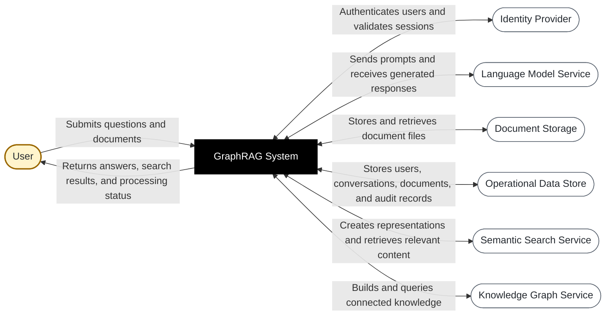
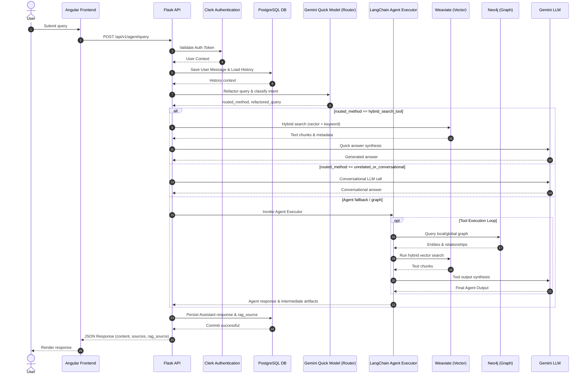
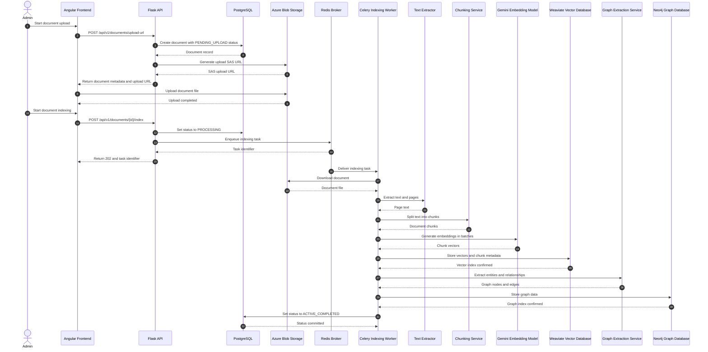
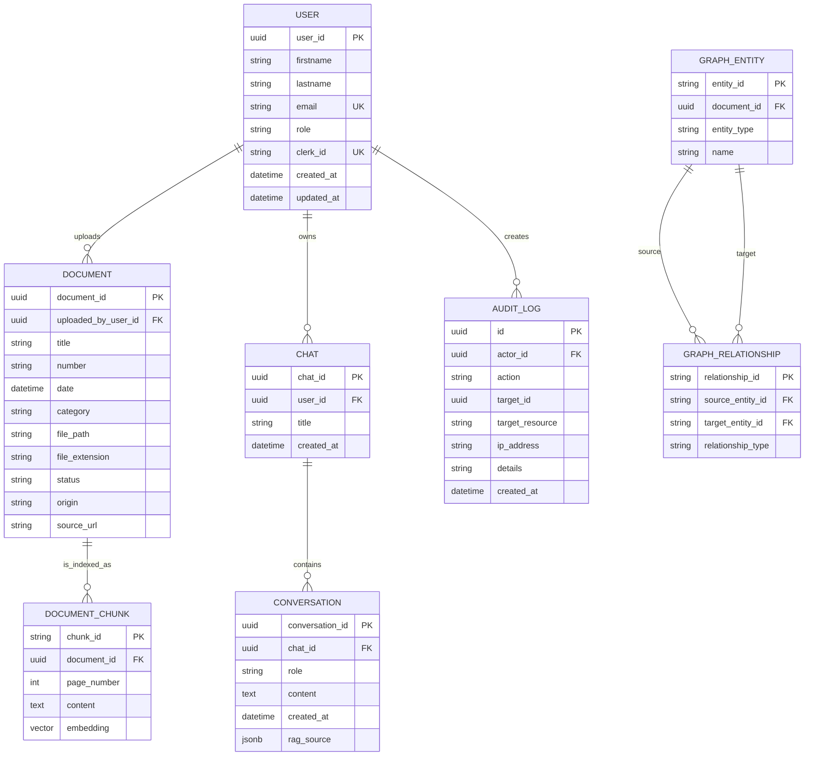
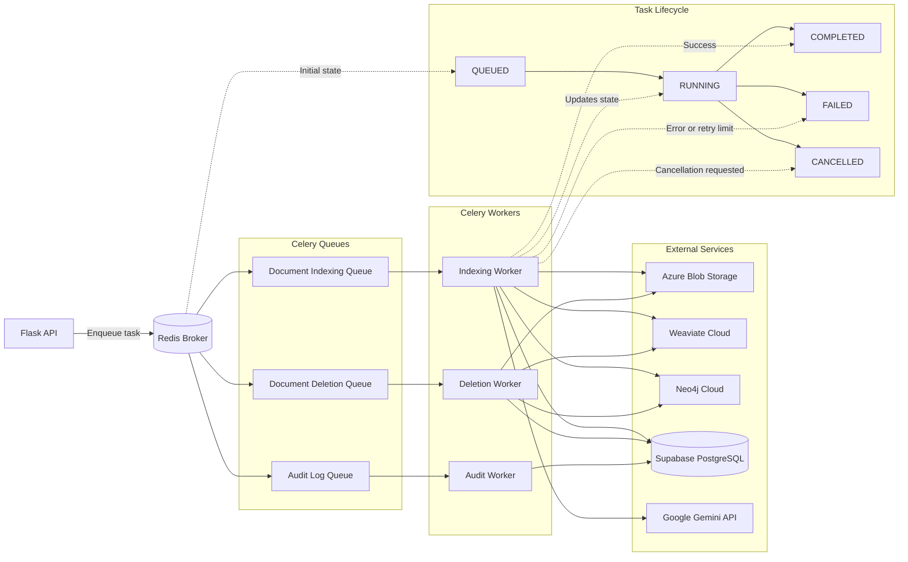

# Attijary GraphRAG

<p align="center">
  <strong>Enterprise regulatory monitoring assistant powered by hybrid GraphRAG search</strong>
</p>

<p align="center">
  <a href="#overview">Overview</a> ·
  <a href="#architecture">Architecture</a> ·
  <a href="#api-reference">API Reference</a> ·
  <a href="#infrastructure--deployment">Infrastructure</a> ·
  <a href="#local-development">Local Development</a>
</p>

<p align="center">
  <a href="https://www.python.org/"></a>
  <a href="https://flask.palletsprojects.com/"></a>
  <a href="https://azure.microsoft.com/"></a>
  <a href="https://www.terraform.io/"></a>
  <a href="https://www.docker.com/"></a>
  <a href="https://github.com/features/actions"></a>
  <a href="https://neo4j.com/"></a>
  <a href="https://weaviate.io/"></a>
</p>

## Overview

Attijary GraphRAG is a full-stack regulatory monitoring platform that enables authorized users to ingest regulatory documents, build searchable knowledge representations, and ask grounded questions over enterprise content.

The project demonstrates production-oriented software engineering across application development, AI orchestration, asynchronous processing, cloud infrastructure, observability, and DevSecOps:

- **Angular frontend** for authentication, document administration, query submission, conversation history, and source-aware answer rendering.
- **Python/Flask API** organized around versioned blueprints and service boundaries.
- **LangChain and GraphRAG** orchestration combining vector, keyword, and graph retrieval.
- **Celery and Redis** for asynchronous document indexing, deletion, and audit workloads.
- **PostgreSQL** for users, documents, chats, conversations, and audit records.
- **Weaviate** for semantic and hybrid retrieval.
- **Neo4j** for entities, relationships, and graph traversal.
- **Azure Blob Storage and Key Vault** for durable document storage and secret management.
- **Terraform and GitHub Actions** for repeatable infrastructure delivery and security automation.

## Table of Contents

- [Application Showcase](#-application-showcase)
- [Core Capabilities](#core-capabilities)
- [Technology Stack](#technology-stack)
- [Architecture](#architecture)
- [API Reference](#api-reference)
- [Enterprise Security and Reliability](#enterprise-security-and-reliability)
- [Infrastructure & Deployment](#infrastructure--deployment)
- [Local Development](#local-development)
- [Repository Structure](#repository-structure)
- [Engineering Notes](#engineering-notes)

## 📸 Application Showcase


<p align="center"></p> 
<p align="center"><em>Grounded conversational query experience with retrieved sources.</em></p>

<p align="center"></p>
<p align="center"><em>Document upload, metadata capture, and indexing workflow.</em></p>

<p align="center"><</p>
<p align="center"><em>Structured administrative audit-log view.</em></p>

<p align="center"></p>
<p align="center"><em>Document graph relationship.</em></p>

## Core Capabilities

### Hybrid GraphRAG query experience

The query pipeline classifies and routes user questions before selecting the most appropriate retrieval strategy:

1. Authenticate the request and load conversation context.
2. Refactor and classify the query with a fast routing model.
3. Use hybrid vector/keyword search for document-grounded questions.
4. Fall back to an agentic graph workflow for entity and relationship-heavy questions.
5. Synthesize an answer with the language model.
6. Persist the response and its retrieval metadata for traceability.

### Document ingestion pipeline

Documents are uploaded directly to Azure Blob Storage using a generated SAS URL. Indexing is deliberately asynchronous so the API remains responsive while workers extract text, create chunks, generate embeddings, write Weaviate vectors, extract graph entities, and persist Neo4j relationships.

### Administrative controls

Document administration and audit-log access are protected with authentication and role-based authorization. Administrators can manage the document lifecycle and review audit activity, while document reads are scoped to the requesting user unless the caller has the administrator role.

## Technology Stack

| Layer | Technologies |
| --- | --- |
| Frontend | Angular 19, TypeScript, SCSS, Nginx |
| API | Python, Flask, Gunicorn, Flask-CORS, SQLAlchemy, Alembic |
| AI/RAG | LangChain, GraphRAG patterns, Google Gemini, hybrid retrieval |
| Data | Supabase PostgreSQL, Weaviate Cloud, Neo4j Cloud |
| Background processing | Celery, Redis |
| Identity and secrets | Clerk authentication, Azure Key Vault, Azure managed identity/OIDC |
| Storage | Azure Blob Storage with SAS-based uploads |
| Platform | Docker, Docker Compose, Azure VM |
| Infrastructure | Terraform with modular production environment configuration |
| Delivery and security | GitHub Actions, CodeQL, Trivy, dependency review |
| Performance validation | Locust and k6 load-testing assets |

## Architecture

### System Context



### Deployment Topology


### RAG Query Sequence



### Document Ingestion Sequence



### Data Model



### Asynchronous Task Architecture



Source diagram files are maintained in [`docs/architecture/`](docs/architecture/), alongside audit-log documentation.

## API Reference

All protected endpoints expect a valid Clerk bearer token in the `Authorization` header. Responses use a consistent JSON envelope where applicable:

```json
{
  "status": "success",
  "data": {},
  "meta": {}
}
```

### Health and readiness

| Method | Path | Auth | Description | Response |
| --- | --- | --- | --- | --- |
| `GET` | `/health` | Public | Lightweight liveness check. | `200` — `{ "status": "healthy", "environment": "..." }` |
| `GET` | `/healthz/ready` | Public | Readiness check for PostgreSQL, Weaviate, and Neo4j connectivity. | `200` when ready; `503` with `{ "status": "unhealthy", "error": "Service temporarily unavailable" }` otherwise |

### Authentication and RBAC

| Method | Path | Auth | Description | Response |
| --- | --- | --- | --- | --- |
| `POST` | `/api/v1/sync` | Clerk bearer token | Synchronizes the authenticated Clerk user with the application database. | `200` — serialized user profile |
| `GET` | `/api/v1/protected-route-test` | Authenticated | Authenticated-access smoke test. | `200` — user ID confirmation |
| `GET` | `/api/v1/admin-route-test` | Admin | Administrator-access smoke test. | `200` — admin user ID confirmation |

### Document ingestion and lifecycle

| Method | Path | Role | Description |
| --- | --- | --- | --- |
| `GET` | `/api/v1/documents/` | Admin | Paginated document list. Supports `page`, `limit`, and optional `status` query parameters. |
| `POST` | `/api/v1/documents/upload-url` | Admin | Creates a `PENDING_UPLOAD` record and returns an Azure Blob SAS upload URL. |
| `POST` | `/api/v1/documents/{document_id}/index` | Admin | Enqueues asynchronous extraction, chunking, embedding, vector indexing, and graph indexing. |
| `GET` | `/api/v1/documents/{document_id}` | Authenticated | Returns a document when the caller owns it or has the admin role. |
| `DELETE` | `/api/v1/documents/{document_id}` | Admin | Marks a document for deletion and enqueues cascading cleanup. |

**Create upload URL request:**

```json
{
  "filename": "regulation-2026.pdf",
  "title": "Regulatory Notice 2026",
  "number": "RN-2026-001",
  "category": "Risk"
}
```

**Create upload URL response (`201`):**

```json
{
  "status": "success",
  "data": {
    "document": {
      "document_id": "uuid",
      "title": "Regulatory Notice 2026",
      "status": "PENDING_UPLOAD"
    },
    "upload_url": "https://storage.example/...sas-token..."
  }
}
```

**Index response (`202`):**

```json
{
  "status": "success",
  "data": {
    "document_id": "uuid",
    "task_id": "celery-task-id",
    "message": "Indexing pipeline enqueued"
  }
}
```

### GraphRAG queries and conversations

| Method | Path | Auth | Description |
| --- | --- | --- | --- |
| `POST` | `/api/v1/agent/query` | Authenticated | Executes the routed GraphRAG/agent flow and persists the conversation. |
| `GET` | `/api/v1/agent/chats` | Authenticated | Lists chat sessions belonging to the authenticated user. |
| `GET` | `/api/v1/agent/chats/{chat_id}/messages` | Authenticated | Returns the messages for a chat session. |

**Query request:**

```json
{
  "query": "What obligations apply to liquidity risk reporting?",
  "chat_id": "optional-chat-uuid"
}
```

**Query response shape:**

```json
{
  "content": "Grounded assistant response...",
  "sources": [],
  "rag_source": {},
  "chat_id": "chat-uuid"
}
```

The exact source and intermediate-artifact fields are service-defined and are persisted with the assistant response to support traceability and future conversation context.

### Audit logs

| Method | Path | Role | Query parameters | Response |
| --- | --- | --- | --- | --- |
| `GET` | `/api/v1/audits/logs` | Admin | `page`, `limit` | `200` — `{ "status": "success", "data": [...], "meta": {...} }` |

Audit entries include actor, action, target resource, target ID, source IP address, details, and creation timestamp. HTTP request logging is emitted as structured JSON with method, path, status, latency, IP, user agent, and authenticated user context where available.

## Enterprise Security and Reliability

- **Authentication:** Clerk-issued bearer tokens are validated by backend middleware.
- **RBAC:** Admin-only routes use a dedicated `admin_required` guard; regular document access is ownership-scoped.
- **Secret management:** Production/staging configurations load secrets from Azure Key Vault; local development uses environment files.
- **Least-privilege CI authentication:** Azure deployments use GitHub Actions OIDC with `id-token: write`, avoiding long-lived cloud credentials in workflows.
- **Structured auditability:** Administrative actions and HTTP requests are represented in structured logs and persisted audit records.
- **Asynchronous isolation:** Long-running ingestion and deletion operations are moved to Celery workers, returning `202 Accepted` and task identifiers to clients.
- **Dependency health:** Readiness checks validate PostgreSQL, Weaviate, and Neo4j connections before traffic is considered healthy.
- **Security scanning:** CodeQL, dependency review, secret scanning, and Trivy infrastructure configuration scans are integrated into GitHub Actions.
- **Operational resilience:** Database connection pooling, pre-ping, recycling, task lifecycle states, retries, and container health checks support production operations.

## Infrastructure & Deployment

Production Terraform is organized under [`infrastructure/terraform/environments/prod`](infrastructure/terraform/environments/prod) and composes reusable modules for Azure storage and the application virtual machine.

### Terraform workflow

```bash
cd infrastructure/terraform/environments/prod
terraform fmt -recursive
terraform init
terraform validate
terraform plan -out=tfplan
terraform apply tfplan
```

The AzureRM backend stores Terraform state in Azure Blob Storage with Azure AD authentication. The provider is configured for Azure OIDC and Azure AD-backed storage access.

### Azure identity and environment setup

The CI workflow authenticates to Azure with GitHub Actions OIDC using:

- `AZURE_CLIENT_ID`
- `AZURE_TENANT_ID`
- `AZURE_SUBSCRIPTION_ID`
- `ARM_USE_OIDC=true`

Runtime workloads use managed identity-oriented configuration for Azure resources and Key Vault access. Keep environment-specific values and private keys in GitHub environment secrets or Azure Key Vault rather than committing them to the repository.

### CI/CD security gates

GitHub Actions workflows cover frontend/backend CI, Docker image builds, infrastructure validation, and production delivery. The infrastructure pipeline:

1. Formats and validates Terraform.
2. Authenticates to Azure through OIDC.
3. Runs Trivy configuration scanning.
4. Creates and uploads a Terraform plan artifact.
5. Applies the approved plan only on pushes to `main` through the protected `production` environment.

Reusable security workflows provide CodeQL analysis, dependency review, and secret scanning. CodeQL is configured for Python analysis and dependency review can fail on high-severity vulnerabilities or unapproved licenses.

## Local Development

### Prerequisites

- Docker Desktop with Docker Compose
- Git
- A configured `.env` file for `backend/`
- A configured `.env` file for `frontend/`
- Access credentials for external services when running the full integration path: Clerk, PostgreSQL/Supabase, Redis, Weaviate, Neo4j, Azure Blob Storage, and Gemini

### Start the application

```bash
git clone https://github.com/chedy322/Attijary-graph-rag.git
cd Attijary-graph-rag

# Create local environment files from your team-approved templates.
# Do not commit secrets.
cp backend/.env.example backend/.env 2>/dev/null || true
cp frontend/.env.example frontend/.env 2>/dev/null || true

# Build and start the frontend, Flask API, and Celery worker.
docker compose up --build
```

The Compose configuration exposes:

- Frontend: `http://localhost:4200`
- Backend API: `http://localhost:3000`
- Backend container port: `5000`
- Liveness endpoint: `http://localhost:3000/health`
- Readiness endpoint: `http://localhost:3000/healthz/ready`

The repository currently expects Redis and several managed services to be supplied through environment configuration. If you prefer to run the backend directly, install the Python dependencies from `backend/requirements.txt` and start the Flask application from the backend source environment.

### Run the Celery worker directly

```bash
cd backend
celery -A celery_worker.celery_app worker --loglevel=info --pool=threads
```

### Frontend-only development

```bash
cd frontend
npm install
ng serve
```

Then open `http://localhost:4200/`.

## Repository Structure

```text
.
├── backend/                         # Flask API, services, models, tasks, and Dockerfile
│   └── src/
├── frontend/                        # Angular application and static hosting configuration
├── infrastructure/
│   └── terraform/
│       ├── environments/prod/       # Production composition and Azure backend config
│       └── modules/                 # Reusable Azure infrastructure modules
├── docs/
│   └── architecture/                # Mermaid architecture and audit-log documentation
├── .github/workflows/               # CI, CD, Terraform, CodeQL, Trivy, and scanning workflows
├── docker-compose.yaml               # Local multi-container orchestration
└── vm-docker-compose.yml             # VM-oriented deployment composition
```

## Engineering Notes

This repository is intentionally structured to demonstrate end-to-end ownership:

- Clear separation between transport-layer blueprints, domain services, persistence models, and asynchronous tasks.
- Versioned API contracts under `/api/v1`.
- Hybrid retrieval that combines semantic similarity, keyword matching, and connected graph context.
- Explicit lifecycle states for document processing and task execution.
- Cloud-native delivery with immutable containers, infrastructure as code, OIDC authentication, and security scanning.
- Architecture artifacts that make system boundaries, data flows, deployment topology, and operational behavior reviewable by engineering teams.
